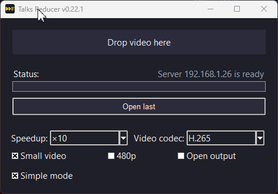
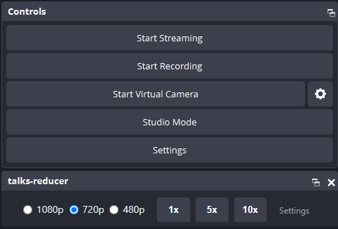

# Talks Reducer [](https://coveralls.io/github/popstas/talks-reducer?branch=master)

Talks Reducer shortens long-form videos by removing silent gaps and optionally
re-encoding them to much smaller files.



## Example

- 1h 37m, 571 MB — Original OBS video recording
- 1h 19m, 751 MB — Talks Reducer
- 1h 19m, 171 MB — Talks Reducer `--small`

## Features

- **Speeds up the silence** — no montage editing.
- **Shrinks the file** — typically 8–10× smaller, web-friendly.
- **Fast** — in-memory processing, auto GPU encoding on NVIDIA, AMD, Intel and
  Apple ([details](docs/cli.md#hardware-encoding)).
- **Extract audio** — export an audio-only `.mp3` instead of video.
- **Simple mode** — one drop zone, minimum settings.
- **Named presets** — save a settings bundle once, apply it on every surface.
- **Watch mode** — convert the latest video from a recordings folder.
- **LNK presets** — drag a video onto a preset shortcut to convert.
- **Mobile app / WebUI** — use a remote server from your phone.
- **CLI mode** — batch files and directories from the terminal.

### Advanced features

- **Cut begin, end, inner fragments** — trim the start and end, mark fragments to drop
  in mpv.net ([how](#removing-fragments-from-the-middle)).
- **OBS integration** — convert buttons inside an OBS dock
  ([setup](#obs-processing-dock-windows)).
- **Remote mode** — offload to your fastest machine ([setup](#remote-server)).
- **Glue** — join several recordings into one video, in the order you choose
  ([how](#command-line)).
- **360° videos** — keep the 360° metadata through gluing and downscaling
  ([details](#360-videos)).

## Install

### Windows

Download the installer from the [releases page](https://github.com/popstas/talks-reducer/releases)

### macOS

```sh
brew trust --tap popstas/apps
brew install --cask popstas/apps/talks-reducer
```

> Homebrew 6.0.0+ requires the tap to be trusted before it will load a cask from it.
> Without `brew trust`, the install fails with a "Refusing to load cask from untrusted
> tap" error. A separate `brew tap` is not needed — `brew install user/tap/cask` taps
> the repository itself.

### pip / pipx / uv (Linux, Windows, macOS)

```sh
pip install talks-reducer      # install the CLI and GUI
pipx install talks-reducer     # or into an isolated environment
uv tool install talks-reducer  # or with uv
```

## OBS Processing Dock (Windows)

For OBS Studio recordings, a Custom Browser Dock starts Talks Reducer right after you stop
a take — pick resolution, silent speed, and codec, then click a button.



**Set it up in OBS:**

1. Start the dock server and keep it running while you record — or let the Windows
   installer add it to autostart:

   ```powershell
   talks-reducer dock-server
   ```

   The dock server is a thin HTTP process: it does not load the processing
   pipeline or the desktop GUI and runs each conversion as a separate
   `talks-reducer` child, so it idles at a few tens of megabytes.

2. In OBS, enable **Tools → WebSocket Server Settings → Enable WebSocket server** and note
   the password.
3. In OBS, open **Docks → Custom Browser Docks…** and add a dock with URL
   `http://127.0.0.1:17890/`.
4. In the dock's **Settings**, enter the OBS WebSocket password and press **Enter**. When
   the status turns green, stop a recording and the speed buttons light up.

Full setup, options, and troubleshooting: [docs/obs-dock.md](docs/obs-dock.md).

## Command line

```sh
talks-reducer input.mp4                                    # tuned encode at the source resolution
talks-reducer --small input.mp4                            # same, scaled down to 720p
talks-reducer --small --480 input.mp4                      # scale down to 480p instead (or --1080)
talks-reducer --small --1080 --fps 30 input.mp4            # 1080p at most, capped to 30 fps
talks-reducer --video-codec mp3 talk.mp4                   # export audio only, as .mp3
talks-reducer --cut-start 00:00:10 --cut-end 00:01:00 demo.mp4  # keep only 10s–60s
talks-reducer --remove "1:20-1:45,12:00-12:30" demo.mp4   # also drop these fragments
talks-reducer --vad demo.mp4   # speed up non-voice frames (Silero VAD; pip install silero-vad-lite)
talks-reducer --url http://localhost:9005 demo.mp4         # process on a remote server
talks-reducer --preset "Smallest" demo.mp4                 # apply a saved preset
talks-reducer --glue part1.mp4 part2.mp4                   # join the parts into one video first
talks-reducer --list-presets                               # print the saved preset names
```

Every input can also be a directory, and you can pass as many as you like in one run. Each
one is processed separately unless you add `--glue`, which concatenates them into a single
video first and names the result after the first part. In the desktop GUI, dropping several
files asks whether to glue them; answering **Yes** opens a **Glue order** list sorted by file
name, where you can move parts up or down (buttons, Alt+↑/↓, or drag) before gluing starts.

`--small` scales to 480p, 720p (default) or 1080p (`--480`, `--720`, `--1080`); `--1080` only
downscales sources taller than 1080 px. `--fps 30|60|orig` (or any positive number) caps the
output frame rate and never raises it. The 1080p and FPS options need an up-to-date server in
remote mode.

`--vad` is the **Speedup no voice** checkbox in the desktop GUI, beside the Silence speedup
buttons in Advanced mode. While it is on the Threshold buttons are disabled, since voice
detection replaces the volume threshold. Simple mode has no checkbox: there the selected
preset decides, and the **Voice** preset turns it on. Remote mode does not support it yet.
Advanced settings add **VAD threshold** (0.05-0.95), **Voice padding, ms** (0-2000) and
**Min pause, ms** (0-5000) rows, remembered between runs and used only while voice detection is
on (Simple mode's Voice preset uses the remembered values). The progress bar gets a **Voice
detection** stage between audio extraction and audio processing.

**Presets** are saved bundles of processing settings (resolution, speeds, threshold, codec, fps,
Speedup no voice) you author once in the desktop GUI's Advanced mode and reuse everywhere —
Simple mode, the Web UI, the OBS dock, and the CLI (`--preset`). When saving you pick which settings the preset
controls, so a preset can be partial (e.g. codec-only) and applying it leaves your other
settings alone. They live in the shared `settings.json`, so one list appears on every surface,
and each surface opens on the preset you used last. See
[docs/cli.md](docs/cli.md#named-presets). A preset's resolution is `orig`, `1080p`, `720p` or
`480p`; fresh installs seed **Compress** as 1080p 30 fps and **Smallest** at 30 fps.

→ Full flag reference — codecs, keyframes, silence thresholds, trimming, remote options:
[docs/cli.md](docs/cli.md).

### Removing fragments from the middle

Besides trimming the start and end, you can cut out fragments from the middle of a video.
In the desktop GUI (Advanced mode, **Cut video** on, a single local file) press **Mark cuts…**
to open the video in [mpv.net](https://github.com/mpvnet-player/mpv.net/releases). Press `c`
where a fragment starts and `c` again where it ends; `C` undoes the last mark. Close the player
and the fragments appear in the **Remove** field, where you can also edit them by hand
(`1:20-1:45, 12:00-12:30.5`). The `?` next to **Remove** opens a
[step-by-step guide](https://telegra.ph/How-to-cut-fragments-out-of-the-middle-of-a-video-in-Talks-Reducer-11-08).

Marks are saved next to the video as `<video>.cuts.json`
(`{"version": 1, "source": "lecture.mp4", "remove": [[80, 105], [720, 750.5]]}`, times in
seconds) and loaded again the next time you add that file.

- **Convert** processes the video as usual and drops the fragments; the output name gets a
  `_cut` suffix (e.g. `lecture_speedup_cut.mp4`).
- **Remove only** is a fast pass for an already-processed file: speeds stay x1, the picture is
  left at its original resolution and frame rate, and only the fragments disappear. The codec
  stays the one you selected.

If mpv.net is installed somewhere unusual, set `mpv_path` in `settings.json` to the full path of
`mpvnet.exe` (or `mpv`). See [docs/gui.md](docs/gui.md#cut-video) for details.

Removing fragments works with local processing only, and Simple mode ignores it. From the
command line use `--remove RANGES` or `--remove-file PATH` (a `.cuts.json` file):

```sh
talks-reducer --silent-speed 1 --sounded-speed 1 --no-small --fps orig --remove "1:20-1:45" lecture_speedup.mp4
```

### 360° videos

Equirectangular 360° recordings keep their 360° metadata (Spherical Mapping
and Stereo 3D) through gluing and processing, so players still show them as
a sphere. With a smaller resolution preset the frame is rescaled with FFmpeg's
`v360` filter instead of `scale`, which would drop the metadata. A light blur,
scaled to the downscale ratio, runs first so the smaller frame does not
shimmer: `v360` has no anti-aliasing of its own.

Limitations: other projections (cubemap, EAC) keep the metadata only at
original resolution (`orig` in the GUI, no `--small` on the CLI); gluing 360°
parts with different resolutions or codecs re-encodes them and drops it. Both
cases are reported in the log.

## Remote server

Run Talks Reducer on the machine with the fast GPU and send jobs to it from anywhere on
your network — laptops, phones, or other desktops.

```sh
talks-reducer server        # browser interface in the terminal
talks-reducer server-tray   # same server, tucked into the system tray
```

Open the printed `http://localhost:9005` address, drop a video on the page, and download
the result when it finishes. Use `--host` and `--port` to bind somewhere else:

```sh
talks-reducer server --host 0.0.0.0 --port 7860
```

Prefer not to touch the terminal? The desktop GUI's **Advanced** panel has a **Run as
server in tray** checkbox that starts the same tray-managed server (and keeps the setting
for next launch).

To send work from another machine, point the CLI or the desktop GUI at the server with
`--url http://<server>:9005` (or `--host <server>`).

→ Server and tray options, the operator view, and scripted uploads:
[docs/server.md](docs/server.md).

## Install as an app (PWA)

The web interface is an installable Progressive Web App. Open it in a Chromium-based
browser and choose **Install app** to get a standalone Talks Reducer window with its own
icon.

Browsers only offer installation over `https://` or `http://localhost`, so put a TLS proxy
in front of a LAN server if the install prompt does not appear.

This also works from a phone: install the page served by a Talks Reducer server on your
network, then upload recordings to it like any other app.

## Changelog

See [CHANGELOG.md](CHANGELOG.md).

## Contributing

See [CONTRIBUTION.md](CONTRIBUTION.md) for development setup details and guidance on sharing improvements.

## License

It grew out of [gegell/jumpcutter](https://github.com/gegell/jumpcutter)
and was renamed from **jumpcutter** to emphasize its focus on conference talks and screencasts.

Talks Reducer is released under the MIT License. See `LICENSE` for the full text.
